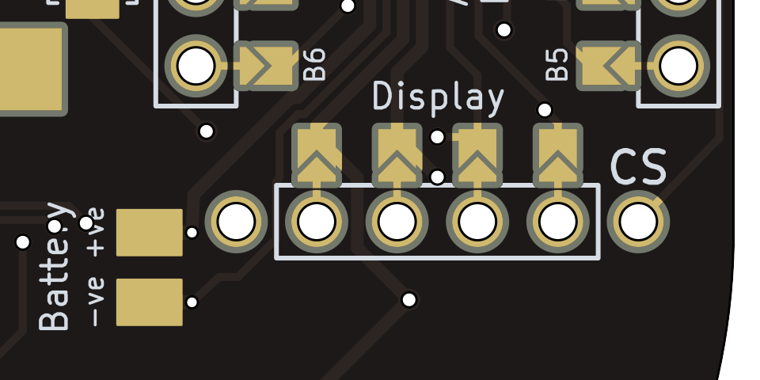

# Arkenswoop build guide

Arkenswoop v0.8.0 uses Bluetooth between halves. Fit each half with its own nice!nano, power switch and battery. Flash the central and peripheral halves with the corresponding builds of your Arkenswoop wireless firmware.

## Non hotswap version

**Important**: the soldered MCU jumper pads should be on the same side as the switches, encoder and MCU ; the diodes should be on the back on the PCB.

1. put your PCBs in front of you, one on each side
2. solder the MCU jumper pads on the top: this will be the side where the keys are
    * for the display jumpers, follow the [instructions for your screen](#display) before installing its socket
    * be careful to solder the jumper pads for the **encoder** on the back!
3. (optional) put the MCU sockets and tape them so that they won't move
    *  if you don't have sockets you can skip this step ; however note that you will have to permanently solder your MCU
4. if using MCU sockets, flip over the PCBs and solder the sockets
    * to make it easier, first solder the corners of the sockets, and ensure everything is aligned correctly before going any further
5. for each diode footprint, solder one pad
6. take a diode, which the mark being on the same side as the silk on the PCB, put it over a pad you have tinned, and heat the pad ; the diode should stay in place nicely
7. solder the other leg of the diode
8. repeat steps 6 and 7 for every other diode
    * if you have trouble putting diodes near each other, try holding them by their legs which twizzers
9. flip your board over, and start placing your switches ; be careful not to bend any pin
    * the switches should stay in place, without any tape
10. solder your switches: your iron should be in contact with both the pad and the pin, then put your solder on the pad and it will melt easily
11. put the encoder and solder its pins in the same fashion

## Display

Choose one display per half. The four holes inside the silkscreen box are the original OLED socket. The two holes just outside the box both carry chip select so that the same PCB can be flipped for the other hand.

### nice!view

1. Orient each half with its switches facing up and the USB connector pointing away from you. Find the five consecutive holes ending at the **CS** mark on that face. The leftmost hole of the six stays empty.
2. Bridge the four **display** jumper pairs on the underside of each half. Leave the four display jumpers on the switch side open. Follow the usual MCU jumper instructions separately.
3. Solder a 1×5, 2.54 mm socket on the switch side. Before inserting the screen, check continuity with power disconnected. Reading left to right from the switch side, the five socket contacts should connect as shown below. Also check that VCC and GND are isolated.
4. Use a 3.3 V nice!nano. Fit the nice!view face up, with its body over the controller and its CS pin in the marked hole. Choose a socket height that clears the controller.

| nice!view contact | Controller connection |
| --- | --- |
| MOSI | Pro Micro D2 / nice!nano P0.17 |
| SCK | Pro Micro D3 / nice!nano P0.20 |
| VCC | 3.3 V VCC |
| GND | GND |
| CS | Pro Micro D1 (TX) / nice!nano P0.06 |

In an Arkenswoop-compatible ZMK configuration, append `nice_view_adapter nice_view` to the existing keyboard shield list for **each half**. This PCB uses the adapter's default pins. The bundled QMK firmware targets earlier wired revisions. [nice!view installation and ZMK instructions](https://nicekeyboards.com/docs/nice-view/getting-started/)

### SSD1306 OLED

For the original four-pin OLED, use the four boxed holes and bridge the four display jumper pairs on the **switch side** only. With USB pointing away, the pin order from left to right is GND, VCC, SCL, SDA. Match the markings on the OLED before applying power.
